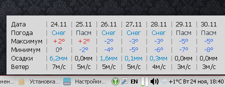

# xfce4-myweather-plugin

Минималистичный и быстрый плагин прогноза погоды для панели **Xfce4**, написанный на C/C++ (GTK3) с использованием бесплатного API [Open-Meteo](https://open-meteo.com) (не требует API-ключей).



## Возможности
* Отображение текущей температуры и погодной иконки прямо на панели Xfce.
* Всплывающее окно по клику с табличным прогнозом на **7 дней** (дата, погода, макс/мин температура, осадки, скорость ветра).
* Выравнивание колонок с точностью до пикселя через Cairo/Pango.
* Включает шрифты **Tahoma** (Regular и Bold) — устанавливаются в систему автоматически вместе с пакетом.
* Автоматическое применение настроек при сохранении файла конфигурации (через `GFileMonitor`).
* Не закрывается при использовании глобальных горячих клавиш (например, для снятия скриншотов).

---

## Установка из готовых пакетов

Скачайте подходящий пакет из раздела [Releases](https://github.com) и установите его в зависимости от вашего дистрибутива:

* **Debian / Ubuntu / Linux Mint (`.deb`):**
  ```bash
  sudo apt install ./xfce4-myweather-plugin_*.deb
  ```
* **РЕД ОС / Fedora / RHEL (`.rpm`):**
  ```bash
  sudo dnf install ./xfce4-myweather-plugin-*.x86_64.rpm
  ```

После установки нажмите правой кнопкой мыши по панели Xfce -> **Панель** -> **Добавить новые элементы...** и выберите **Погода (Open-Meteo)**.

---

## Сборка из исходников

### 1. Установка зависимостей
Поддерживаются Debian/Ubuntu (`apt`), РЕД ОС / Fedora (`dnf`) и Arch Linux (`pacman`):
```bash
make deps
```

### 2. Компиляция и установка в систему
```bash
make
sudo make install
```

### 3. Сборка пакетов (`.deb`, `.rpm`, `.src.rpm`)
* Сборка `.deb`-пакета:
  ```bash
  make deb
  ```
* Сборка бинарного `.rpm`-пакета (адаптировано под РЕД ОС 7.3 / 8 и Fedora):
  ```bash
  make rpm
  ```
* Сборка исходного `.src.rpm`-пакета (SRPM) для чистой пересборки:
  ```bash
  make srpm
  ```
  Для пересборки бинарного RPM из `.src.rpm` на целевой системе:
  ```bash
  sudo dnf builddep ./xfce4-myweather-plugin-*.src.rpm
  rpmbuild --rebuild ./xfce4-myweather-plugin-*.src.rpm
  ```

---

## Настройка

При первом запуске системный конфиг `/etc/xdg/myweather.conf` автоматически копируется в `~/.config/myweather.conf`. Вы можете открыть его прямо из меню плагина (ПКМ по плагину -> **Открыть настройки**).

| Параметр | По умолчанию | Описание |
| :--- | :--- | :--- |
| `lat` | `53.13` | Широта (координаты вашего города) |
| `lon` | `45.0` | Долгота |
| `timezone` | `Europe%2FMoscow` | Часовой пояс (в формате URL-encoded) |
| `font_desc` | `Tahoma 10` | Шрифт и размер текста во всплывающем окне |
| `panel_font` | `Tahoma 8` | Шрифт и размер текста на самой панели |
| `panel_color` | `#000000` | Цвет текста на панели (HEX) |
| `max_tooltip_px` | `423` | Максимальная ширина всплывающего окна в пикселях |
| `update_interval` | `1800` | Интервал обновления погоды в секундах (по умолчанию 30 мин) |
| `offset_x` | `-1` | Смещение всплывающего окна по горизонтали (px) |
| `offset_y` | `-3` | Смещение всплывающего окна по вертикали (px) |

---

## Удаление

Если плагин был установлен из пакета, удалите его через пакетный менеджер (`sudo apt remove xfce4-myweather-plugin` или `sudo dnf remove xfce4-myweather-plugin`).

При ручной установке через `make install`:
* Удалить плагин из системы (с сохранением настроек):
  ```bash
  sudo make uninstall
  ```
* Полное удаление вместе с системным конфигом:
  ```bash
  sudo make purge
  ```

---

## Источники данных и лицензия

* Погодные данные предоставлены [Open-Meteo.com](https://open-meteo.com) по лицензии [CC BY 4.0](https://creativecommons.org).
